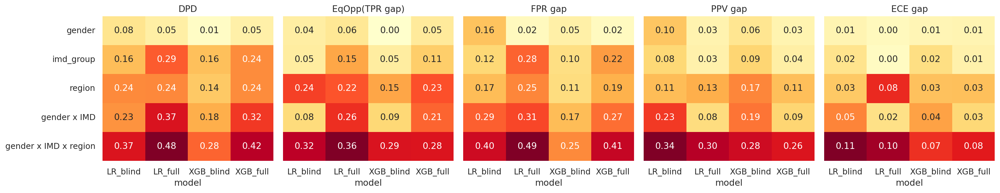
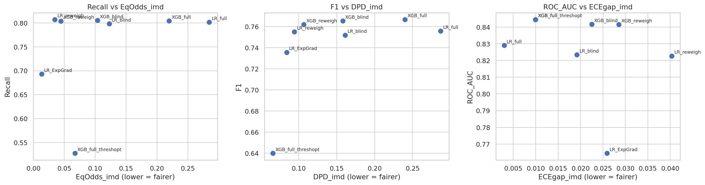
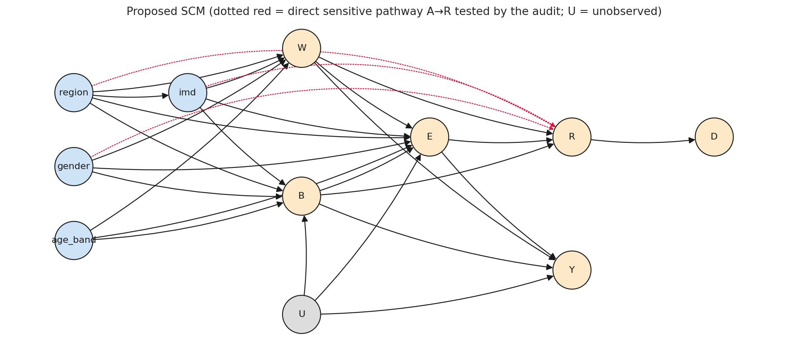
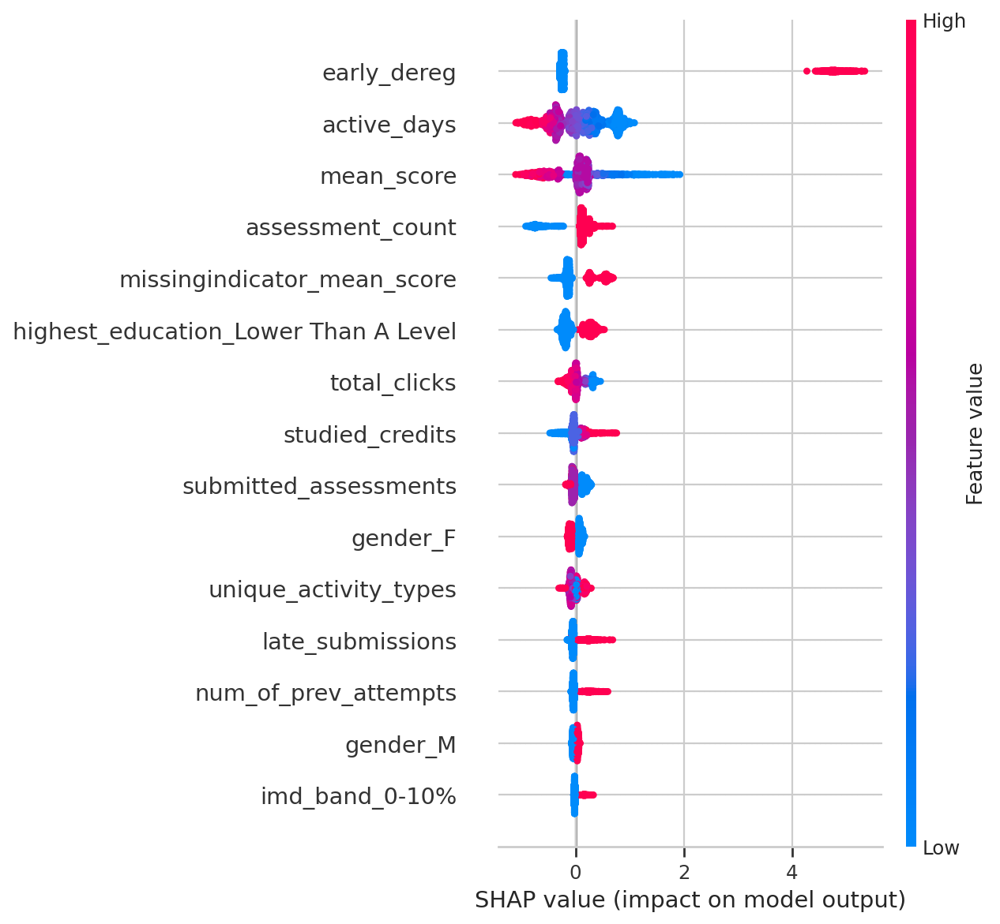

# FAIRPATH-EDU

### Causal and Counterfactual Fairness in Early Student Risk Prediction

**A reproducible, intersectional fairness-auditing workflow for early student-risk prediction using the Open University Learning Analytics Dataset (OULAD).**

**Authors:** Shreeya Kamath and Misha  
**Academic context:** Fairness in Machine Learning — mini-project  
**Status:** Research notebook and archived experimental results included (41 output artifacts).

[](https://colab.research.google.com/github/USERNAME/FAIRPATH-EDU/blob/main/notebooks/FAIRPATH-EDU.ipynb)

> Replace `USERNAME` in the Colab link with your GitHub username after publishing.

## Overview

Predictive systems can help educators identify students who may need additional academic support, but prediction quality alone does not establish fairness. **FAIRPATH-EDU** studies early-warning predictions and their potential disparities across gender, area-level socioeconomic deprivation (Index of Multiple Deprivation, IMD), geographic region, and intersecting subgroups. The project combines conventional predictive evaluation with statistical fairness auditing, a proposed structural causal model, counterfactual sensitivity analysis, mitigation experiments, and model explainability.

The target is derived from the OULAD `final_result` field: **at risk = Fail or Withdrawn**. Features are constructed using information available through **day 28** of the course. The project is a research audit, **not** an automated student-intervention system.

## Research objectives

1. Construct an early-window student-risk prediction pipeline and evaluate predictive performance with student-group-separated data splits.
2. Quantify disparities in prediction outcomes across individual and intersecting demographic/socioeconomic groups, including uncertainty and significance testing.
3. Explore proposed causal relationships and counterfactual sensitivity under explicit structural-model assumptions.
4. Compare fairness-mitigation approaches and interpret model behavior, emphasizing human-reviewed supportive interventions.

## Dataset

**Open University Learning Analytics Dataset (OULAD)** — historical UK distance-learning records from 2013–2014. The notebook attempts to download the dataset from a UCI-hosted mirror and then the Open University source. If automatic retrieval fails in Colab, it requests a manual upload of the dataset ZIP or required CSV files.

Required CSV files: `assessments.csv`, `courses.csv`, `studentAssessment.csv`, `studentInfo.csv`, `studentRegistration.csv`, `studentVle.csv`, and `vle.csv`.

- UCI dataset: https://archive.ics.uci.edu/dataset/349/open+university+learning+analytics+dataset
- Open University source: https://analyse.kmi.open.ac.uk/open_dataset

The raw dataset is **not included** in this repository. Consult the dataset provider's terms and cite the original dataset when using the research.

## Methodology

```text
OULAD data acquisition
        |
        v
Day-28 feature engineering and integration
        |
        v
Exploratory subgroup disparity analysis
        |
        v
Student-group-separated train / validation / locked-test split
        |
        v
Logistic Regression and XGBoost (full vs. sensitive-feature-blind)
        |
        v
Predictive evaluation + intersectional fairness auditing
        |
        +--> Significance tests and fairness-criteria comparisons
        |
        +--> Proposed causal graph, adjusted effects, sensitivity analysis
        |
        +--> Counterfactual sensitivity under SCM assumptions
        |
        +--> Reweighing / Fairlearn reductions / optional post-processing
        |
        v
Explainability, subgroup errors, model card, exported results
```

### Modelling and evaluation

The notebook uses `StratifiedGroupKFold` to create approximately **60/20/20** training, validation and test partitions while checking that student IDs do not overlap. It trains regularized **logistic regression** and **XGBoost** models with and without selected sensitive attributes. Validation data is used for model selection and threshold selection; a held-out test partition is used for reported evaluation. The default threshold selection aims for **80% recall on validation data**, not a guaranteed recall on the test set.

Reported evaluation routines include balanced accuracy, precision, recall, F1, ROC-AUC, PR-AUC, Brier score, expected calibration error, and confusion matrices. Fairness analysis includes group-level outcomes, disparities, statistical tests, and intersectional comparisons; groups below configured support thresholds are treated cautiously.

### Causal and counterfactual analysis

A proposed structural causal model (SCM) is used to explore adjusted associations and counterfactual sensitivity. **Its causal graph is a hypothesis; observational data alone do not validate the graph or establish causal effects.** Results depend on identification and modelling assumptions, including potential unobserved confounding.

### Mitigation and interpretation

The notebook includes reweighing, Fairlearn `ExponentiatedGradient` reductions (demographic parity or equalized odds constraint), and optional post-processing, followed by comparative evaluation. Logistic-regression coefficients, SHAP summaries, and subgroup error analysis support interpretation. Mitigation should be evaluated for both predictive utility and multiple fairness criteria; no method is universally fair.

## Repository structure

```text
FAIRPATH-EDU/
├── README.md
├── notebooks/
│   └── FAIRPATH-EDU.ipynb
├── results/
│   ├── README.md
│   └── fairpath_outputs.zip
├── figures/
│   ├── fairness_dashboard_heatmap.png
│   ├── mitigation_tradeoff.png
│   ├── confusion_matrices.png
│   ├── scm_dag.png
│   ├── shap_summary.png
│   ├── calibration_overall.png
│   └── README.md
├── requirements.txt
├── .gitignore
└── CITATION.cff
```

The supplied experiment archive is included under `results/`; selected figures are extracted into `figures/` for direct viewing. The notebook is retained unchanged. The ZIP contains 41 artifacts (CSV, PNG and JSON).

## Run in Google Colab

1. Open `notebooks/FAIRPATH-EDU.ipynb` in Colab (or use the badge after replacing `USERNAME`).
2. Choose **Runtime → Run all**. A CPU runtime is sufficient according to the notebook instructions.
3. The setup cell installs selected dependencies; the data cell downloads OULAD or prompts for manual upload.
4. The notebook saves outputs to `/content/fairpath_outputs/` and creates `/content/fairpath_outputs.zip` at the end.
5. Download and retain the ZIP as an experiment artifact. Review the exported CSV, PNG and JSON files before making performance claims.

The notebook documentation estimates roughly **15–30 minutes**, depending on the runtime and settings. To reduce experimentation time, edit `N_BOOT`, `N_PERM`, and `N_XGB_CONFIGS` in the configuration cell. Full experiments can take longer.

**Local execution note:** The supplied notebook is Colab-oriented and uses absolute `/content/...` paths and Colab upload/download helpers. Running it locally requires adapting these paths and the data-upload fallback. The original notebook has been preserved without modifications.

## Configuration and reproducibility

The notebook's defaults include:

| Parameter | Default | Meaning |
|---|---:|---|
| `SEED` | 42 | Random seed |
| `CUTOFF_DAY` | 28 | Early-warning feature window |
| `EXCLUDE_EARLY_DEREG` | `False` | Whether to exclude students already de-registered by day 28 |
| `TARGET_RECALL` | 0.80 | Validation-stage threshold objective |
| `MIN_GROUP_N` | 100 | Minimum group size for reporting |
| `MIN_CLASS_N` | 20 | Minimum positive and negative support per group |
| `N_BOOT` | 300 | Bootstrap repetitions |
| `N_PERM` | 2000 | Permutation repetitions |
| `N_BOOT_CAUSAL` | 200 | Causal-analysis bootstrap repetitions |
| `PRIMARY_MODEL` | `XGB_full` | Detailed-audit model |
| `MITIGATION_ATTR` | `imd_group` | Mitigation target attribute |

**Potential leakage consideration:** `early_dereg` is known by the day-28 cutoff but closely related to the `Withdrawn` outcome. The notebook explicitly discusses this issue and provides `EXCLUDE_EARLY_DEREG` as a sensitivity setting. This choice should be reported in any study conclusions.

The `requirements.txt` lists the directly used Python libraries without pinning versions. For exact reproduction, record the versions from the successful Colab runtime and save an environment lock or package-freeze file.

## Archived experimental results

The following values are **transcribed from the supplied `fairpath_outputs.zip`**, not independently rerun or verified. The `model_card.json` identifies `XGB_full` as the primary model, with a validation threshold chosen to target 0.80 recall. The archived dataset summary reports **32,593 records**, with **19,572 training**, **6,532 validation**, and **6,489 test** records.

### Held-out test performance (primary XGB_full model)

| Metric | Archived value |
|---|---:|
| Balanced accuracy | 0.742 |
| Precision | 0.732 |
| Recall | 0.804 |
| F1 | 0.767 |
| ROC-AUC | 0.845 |
| PR-AUC | 0.880 |
| Brier score | 0.158 |
| Expected calibration error (ECE) | 0.014 |
| Flag rate | 0.573 |

The `test_performance.csv` also includes bootstrap intervals and comparisons against `LR_full`, `LR_blind`, and `XGB_blind`. These scores describe prediction performance, **not proof of fairness**.

### Fairness and mitigation findings

The archive includes group-specific metrics, disparity gaps, intersectional audits, significance testing, and a mitigation comparison table. The mitigation configuration in `model_card.json` targets **IMD group** with an **EqualizedOdds** constraint and full features. Fairness trade-offs should be evaluated across all protected-group definitions rather than claiming one mitigation universally resolves disparities.





### Causal and interpretability artifacts





The proposed causal structure and estimated effects depend on modelling assumptions and should not be interpreted as experimentally identified causal truths.

### Archived outputs

Download [`fairpath_outputs.zip`](results/fairpath_outputs.zip) for all 41 exported artifacts. The archive includes `model_card.json`, `test_performance.csv`, `fairness_gaps_all_models.csv`, `mitigation_comparison.csv`, `causal_effect_estimates.csv`, counterfactual tables, SHAP figures, calibration plots and other diagnostics. See [`results/README.md`](results/README.md) for the complete inventory and provenance notes.

## Ethical considerations and limitations

- Risk flags should prompt **supportive human review**, not automatic punitive decisions.
- OULAD represents historical UK higher-education settings and does not establish transferability to other countries or current cohorts.
- IMD is an **area-level proxy**, not a direct measure of an individual's income or deprivation.
- Small intersectional groups may produce unstable fairness estimates.
- Observational causal and counterfactual estimates depend on unverified assumptions.
- Fairness criteria may conflict; optimizing one criterion does not guarantee fairness overall.
- The notebook is a research workflow, not a validated deployment-ready decision-support product.

## Citation

See [`CITATION.cff`](CITATION.cff) for repository citation metadata. Add a publication DOI only after an actual publication or archival release exists. Also cite OULAD and any relevant libraries or methods in formal reports.

## License

No license has been assigned in this package. Add a license only after confirming agreement from all contributors and any institutional requirements. Without a license, others do not automatically receive broad permission to reuse the code.
